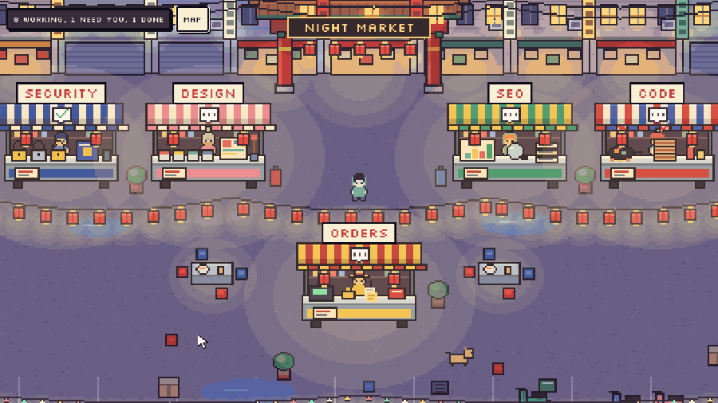
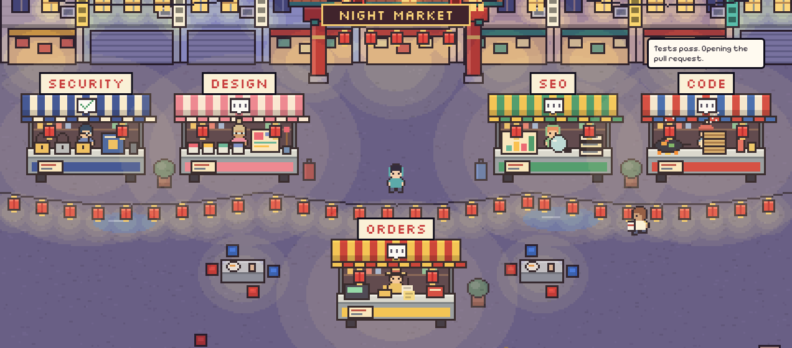
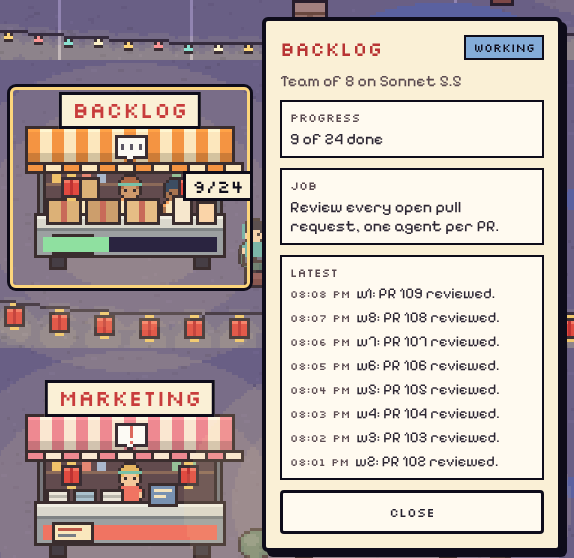
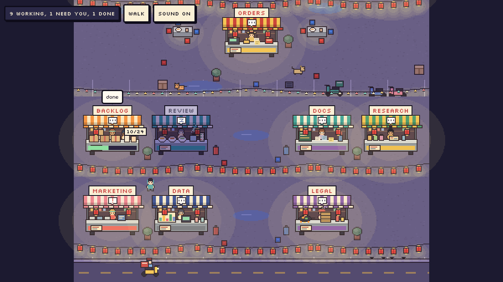
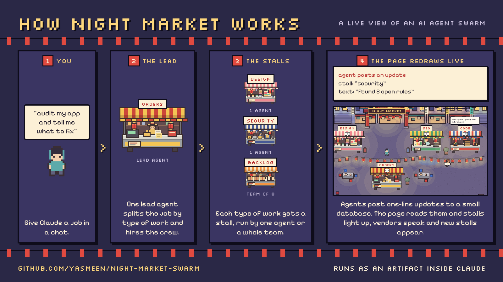

# Night Market Swarm

A walkable pixel-art night market for watching AI agent swarms work.



The same demo with sound: [docs/demo.mp4](docs/demo.mp4)

Each booth is a job. A booth can be one agent or a team of agents. Lit booths are working, vendors say their latest update out loud, couriers run tickets to the Orders counter, and the market grows a new lane when more agents are hired. You walk around with the arrow keys, WASD, or by tapping, and open a booth's card to read what its agents are doing. On a phone, tap a booth to open its card and hold and drag to walk.

## Screenshots

| The gate and the Orders counter | A team booth and its card |
| --- | --- |
|  |  |



A one-page breakdown of how it works, how it was built and how booths compose: [docs/how-it-works.png](docs/how-it-works.png)

## What is here

- `skills/night-market-swarm/` A skill that tells Claude how to publish the page and run a swarm on it.
- `docs/` The demo and screenshots shown here.

- `page/` The scene itself: one `index.html` plus its art. It reads its state from a small document store and draws whatever is there.
- `art/` The Python scripts that draw every sprite and background (Pillow only, no image assets by hand).
- `harness/` A Playwright test rig that runs the page against mock data and records a demo.

## How the page gets its data

The page expects a `claude` object with a `db` capability, as provided to pages published as Claude artifacts. It listens to three collections:

- `swarms/<id>`: `{project, job, createdAt, demo?}`.
- `swarms/<id>/stalls/<stallId>`: `{name, sprite, order, role, model, status, statusAt, task, crew?, total?, look?}`.
- `swarms/<id>/events/<eventId>`: `{stall, at, text, status?, worker?, unit?, done?}`.

The lead's stall id is `orders`. `status` is one of `idle, working, done, needs_you, blocked, closed`.

### Booth looks

Every night market booth is composed in the browser from parts, so a new agent can get its own booth without new art. Set `look` on a stall to override any part:

```json
{ "awning": ["#2f6f5e", "#f6e7c8"], "panel": "#2f6f5e", "goods": "boba", "hair": "#463e4c", "shirt": "#90c698", "skin": "#f4d0ae", "acc": ["glasses"] }
```

- `goods`: `orders, lock, paint, seo, wok, parcels, bowls, plan, curios, scrolls, chart, fruit, boba`
- `acc`: any of `straw, beanie, bun, band, glasses, apron, hood`
- `sprite` picks a preset look: `security, design, seo, code, backlog, review, docs, research, marketing, data`. Anything else gets a stable look derived from the stall id.

### Team booths

Set `crew` to the number of agents working a booth and `total` to the number of units of work. Each agent posts an event with `worker`, a `unit` id and `done: true` when it finishes a unit. The booth shows the headcount, a progress bar and a count such as `12/24`.

## Install

You need a Claude plan with Claude Code on the web, since the swarm runs in a cloud session with subagents and artifact tools.

1. Start a new Claude Code session in the Claude app or at claude.ai/code.
2. Send it this, with your own job at the end:

   ```
   Clone github.com/yasmeen/night-market-swarm, follow skills/night-market-swarm/SKILL.md, and open a market for: <your job>
   ```

3. On the first run Claude publishes the page from `page/` as a private artifact in your account and gives you its link. Later runs reuse that page and open a new market on it.

To keep it as a permanent skill, zip the `skills/night-market-swarm` folder and upload it in Claude's Skills settings ([how to add a custom skill](https://support.claude.com/en/articles/12512180-using-skills-in-claude)). Claude still needs this repo for the first run, because that is where the page files are.

The first-run setup has only been done on one account so far. If a step fails, open an issue with what Claude said.



## Sound

The page plays small synthesized sound effects: a blip on hover, a two-note sound when a card opens or closes, footsteps, a note when an agent posts, a rising tick when a team finishes a unit, an alert when an agent needs you, and a pop when a new booth appears. Browsers block audio until the first click or key press, so the page is silent until then. The "Sound on / Sound off" button next to Map turns it off.

## Run the test rig

```
cd harness
npm install
node shots4.js      # screenshots into the working folder
node record2.js     # frame capture of a scripted demo
```

The rig expects Google Chrome at `/usr/bin/google-chrome`. Edit `common.js` if yours is elsewhere, and adjust the output paths in the scripts.

## Regenerate the art

```
cd art
pip install pillow
python3 layers.py ../page && python3 sprites.py ../page && python3 art2.py ../page && python3 parts.py ../page
```

The scripts grew one at a time and import each other, so run them in that order.

## Status

Early. Built in one sitting and tested in a local browser with mock data. The packaged skill that opens a market from a chat and runs the agents is not in this repo yet.

## License

MIT. See `LICENSE`.
